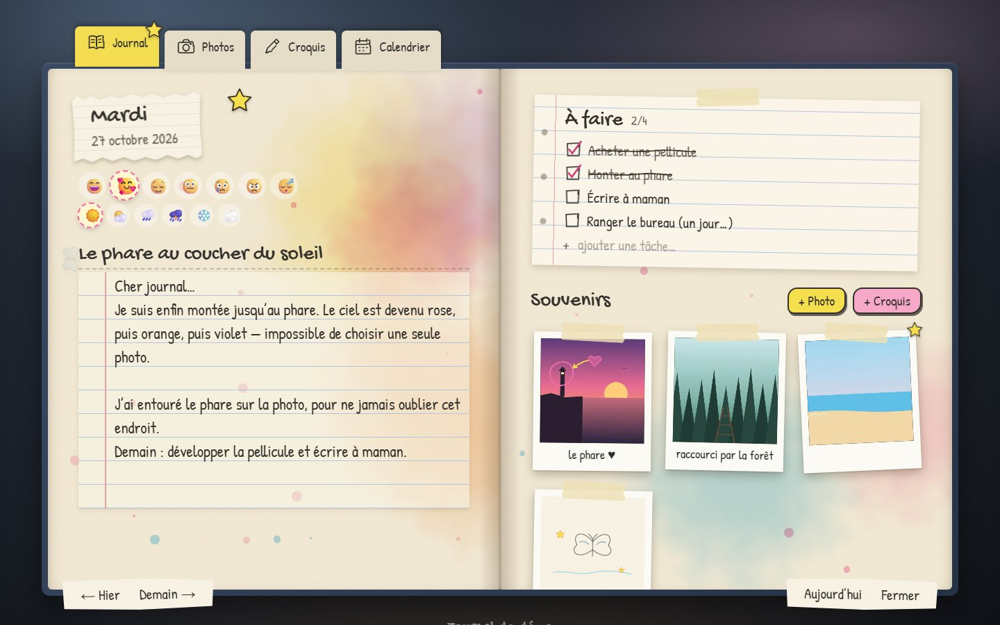
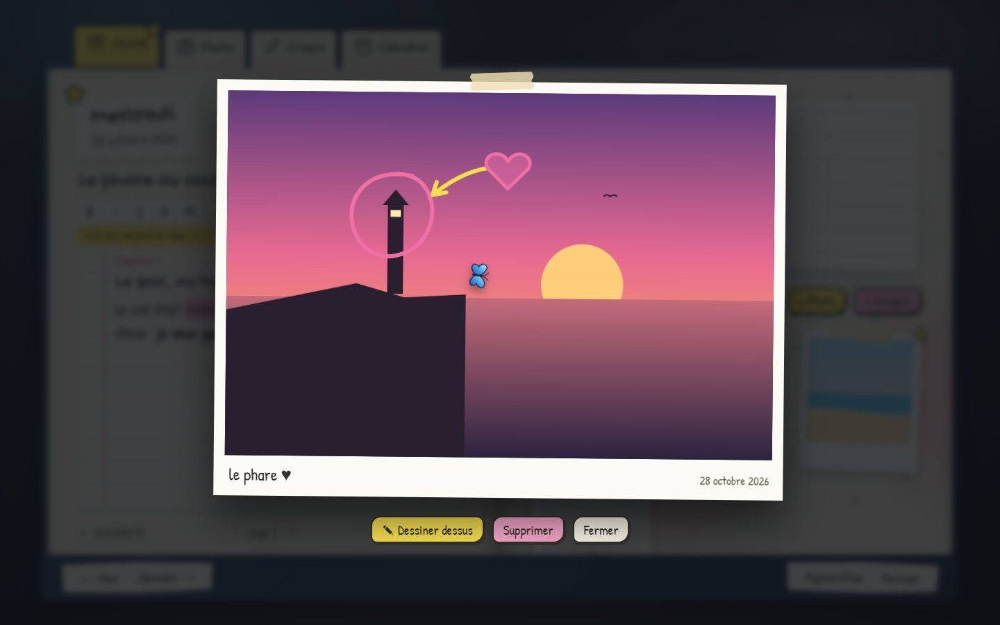
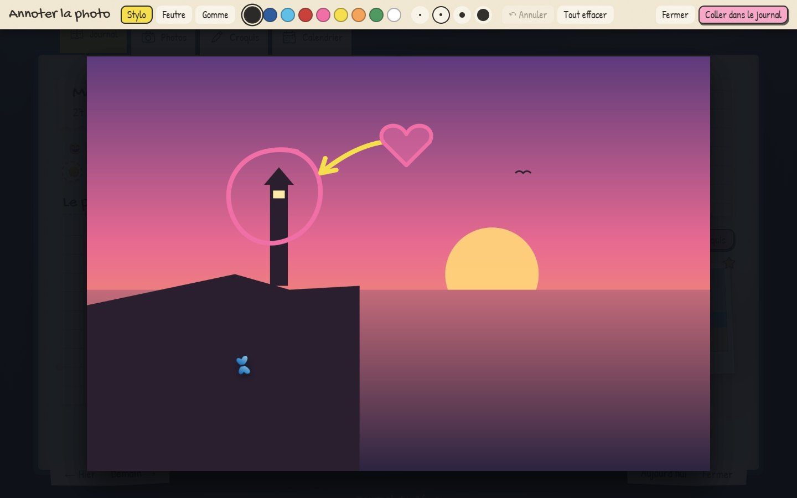
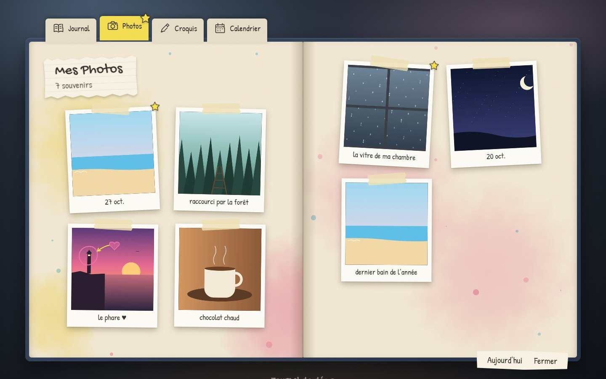
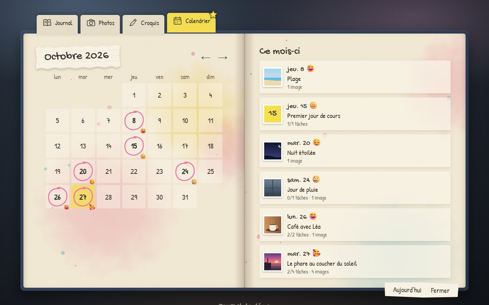
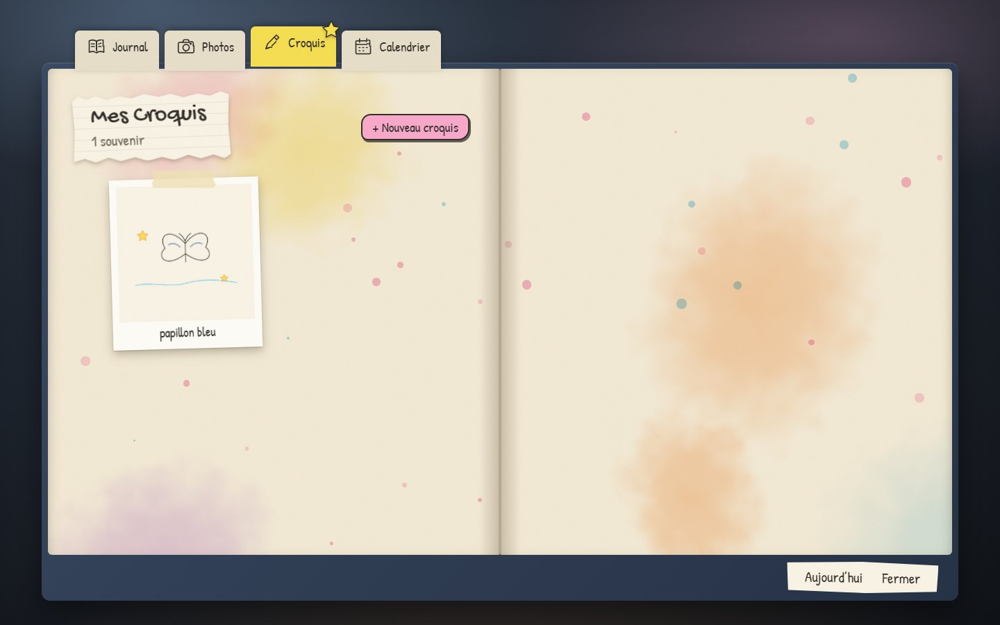
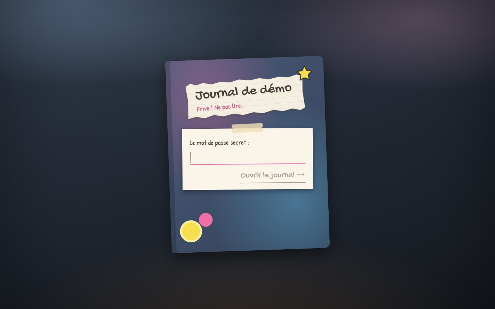
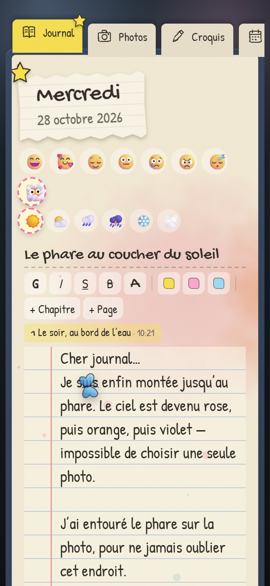

# 📓 Journal — carnet de vie façon aquarelle

Un journal intime auto-hébergé : pages crème, taches d'aquarelle, polaroïds scotchés,
étoiles jaunes, écriture manuscrite et un petit papillon bleu qui passe de temps en temps.

> 🎮 **Inspiration** : le design est inspiré du journal de Max dans le jeu vidéo
> **[Life is Strange](https://lifeisstrange.square-enix-games.com/)** (Dontnod / Square Enix).
> Ce projet est une création personnelle de fan, non officielle et sans lien avec ses éditeurs :
> aucune ressource du jeu (images, polices, sons) n'est utilisée. Tous les visuels sont recréés en CSS/SVG.

L'ancienne to-do list (JavaScript vanilla) est conservée dans [`legacy/`](legacy/) ; ses tâches vivent
maintenant dans la liste « À faire » de chaque journée.

## 📸 Aperçu



| Photo annotée | Éditeur de dessin |
| --- | --- |
|  |  |
| **Album photos** | **Calendrier** |
|  |  |
| **Carnet de croquis** | **Couverture (connexion)** |
|  |  |

<p align="center"></p>

*Captures réalisées sur une instance de démonstration avec de fausses données.*

## ✨ Fonctionnalités

- **Une double page par jour** : date sur papier déchiré, humeurs (plusieurs à la fois, dont « Dans les nuages ») et météo en stickers, titre.
- **Un carnet page par page** : le texte s'écrit sur des pages lignées de taille fixe, sans défilement. Quand une page est pleine, la suite passe toute seule à la page suivante ; « + Page » (ou Ctrl+Entrée) commence une nouvelle page sans finir la courante. Enregistrement automatique.
- **Chapitres** : « + Chapitre » ouvre un nouveau chapitre dans la même journée (numéroté, avec l'heure). Le sommaire du jour permet d'y sauter.
- **Mise en forme** : gras, italique, souligné, barré, texte en grand, surligneur jaune / rose / bleu.
- **Correcteur français** : fautes d'orthographe soulignées en rouge, de grammaire en bleu ; clic droit pour les suggestions, « Ignorer » ou « Ajouter au dictionnaire ». Moteur LanguageTool exécuté en local (le texte ne quitte pas la machine) ; s'il ne répond pas, le correcteur du navigateur prend le relais.
- **À faire** : tâches du jour, cochées au stylo et barrées à la main.
- **Souvenirs** : ajoute des photos (bouton ou glisser-déposer) ; elles apparaissent en polaroïds.
- **Dessiner sur les photos** : stylo (sensible à la pression avec un stylet), feutre transparent, gomme, 9 couleurs, annuler (Ctrl+Z). L'annotation est un calque séparé : la photo d'origine n'est jamais modifiée.
- **Croquis** : pages blanches à dessiner, rangées dans le carnet de croquis.
- **Albums** Photos / Croquis feuilletables, **calendrier** avec les jours remplis entourés.
- **Animations** : feuilletage des pages, polaroïds qui tombent et se « développent », étoiles qui popent, papillon (désactivé si le système demande moins d'animations).
- Navigation au clavier : ← / → pour changer de jour.
- Responsive : sur téléphone, les pages s'empilent.

## 🧱 Stack

| Partie | Outils |
| --- | --- |
| Front | React 18, Vite, Framer Motion, polices Patrick Hand & Gochi Hand (auto-hébergées via Fontsource) |
| API | Node.js, Express, `pg`, Multer, Sharp (rotation EXIF, redimensionnement, vignettes WebP) |
| Données | PostgreSQL 17 (texte, tâches, métadonnées) + volume Docker pour les images |
| Éditeur | TipTap (ProseMirror), pages en colonnes CSS |
| Correcteur | LanguageTool 6.8 (conteneur local, ~1 Go de RAM) |
| Ops | Docker Compose, conteneur de sauvegarde automatique, Caddy (HTTPS) en option |

## 🚀 Lancer sur ton PC

Prérequis : Docker Desktop.

```bash
cp .env.example .env
```

Dans `.env`, remplis au minimum `APP_PASSWORD`, `SESSION_SECRET` et `POSTGRES_PASSWORD`
(génère des valeurs avec `openssl rand -hex 32`). Puis :

```bash
docker compose up -d --build
```

Ouvre <http://localhost:8080> et entre ton mot de passe.

Par défaut le journal n'écoute que sur ce PC (`APP_BIND=127.0.0.1`). Pour y accéder depuis ton
téléphone sur le même Wi-Fi, mets `APP_BIND=0.0.0.0` puis ouvre `http://<ip-du-pc>:8080`.

## 🌍 Héberger sur un VPS (HTTPS)

1. Fais pointer un nom de domaine (enregistrement A) vers l'IP du VPS.
2. Copie le projet sur le VPS, crée le `.env` et ajoute :
   ```
   DOMAIN=journal.mondomaine.fr
   COOKIE_SECURE=true
   TRUST_PROXY=true
   ```
3. Lance avec le profil HTTPS (Caddy obtient le certificat Let's Encrypt tout seul) :
   ```bash
   docker compose --profile https up -d --build
   ```
4. Ouvre les ports 80 et 443 du pare-feu. Le port 8080 reste limité à `127.0.0.1`.

## 💾 Sauvegardes

Le service `backup` fait au démarrage puis toutes les `BACKUP_INTERVAL_HOURS` heures :

- `backups/db_<date>.dump` — la base (format `pg_dump` custom) ;
- `backups/uploads_<date>.tar.gz` — toutes les images ;
- suppression des sauvegardes de plus de `BACKUP_KEEP_DAYS` jours.

Le dossier se règle avec `BACKUP_DIR` (ex. un disque externe ou un dossier synchronisé avec un cloud).
Pour une copie hors du serveur, synchronise ce dossier (rclone, Syncthing, rsync…).

Sauvegarde manuelle immédiate :

```bash
docker compose exec backup sh /scripts/backup.sh once
```

Restaurer (⚠️ remplace les données actuelles) :

```bash
docker compose stop app
```

```bash
docker compose run --rm --entrypoint sh backup /scripts/restore.sh 2026-10-27_030000
```

```bash
docker compose start app
```

Sans horodatage, `restore.sh` liste les sauvegardes disponibles.
Sous Git Bash (Windows), préfixe les commandes avec `MSYS_NO_PATHCONV=1`.

Les images supprimées depuis l'appli sont seulement masquées : le fichier reste sur le disque.

### 🚚 Réinstaller sur un nouveau VPS à partir d'une sauvegarde

Procédure testée sur une installation vierge (base vide, volumes neufs) : textes, tâches, photos
et annotations reviennent à l'identique.

1. Sur le nouveau serveur : installe Docker, clone le dépôt, recrée le `.env`.
   Garde le même `APP_PASSWORD` si tu veux le même mot de passe. Les autres secrets peuvent changer :
   un nouveau `SESSION_SECRET` demande seulement de se reconnecter.
2. Copie les deux fichiers d'une même sauvegarde (`db_<date>.dump` et `uploads_<date>.tar.gz`)
   dans le dossier `BACKUP_DIR` (par défaut `./backups`).
3. Démarre uniquement la base, restaure, puis lance le reste :
   ```bash
   docker compose up -d db
   ```
   ```bash
   docker compose run --rm --entrypoint sh backup /scripts/restore.sh <date>
   ```
   ```bash
   docker compose --profile https up -d --build
   ```

### ⚠️ Ce que la sauvegarde ne couvre pas

- **Une panne du serveur lui-même** : par défaut les sauvegardes sont sur le même disque que les données.
  Copie régulièrement `BACKUP_DIR` ailleurs (autre machine, cloud, disque externe), idéalement chiffré :
  c'est un journal intime.
- **Le fichier `.env`** : il n'est pas sauvegardé (il contient les secrets). Range-le dans un gestionnaire de mots de passe.
- **Les échecs** : une sauvegarde ratée est seulement écrite dans les logs (`docker compose logs backup`) ; aucune alerte n'est envoyée.

## ✍️ Changer la police

Les polices manuscrites sont définies en haut de [`web/src/styles.css`](web/src/styles.css)
(`--font-hand` et `--font-title`). Pour utiliser une police à toi (fichier `.woff2`/`.ttf` dont tu as la licence) :

1. Place le fichier dans `web/public/fonts/`, par exemple `ma-police.woff2`.
2. Ajoute en haut de `styles.css` :
   ```css
   @font-face { font-family: 'MaPolice'; src: url('/fonts/ma-police.woff2') format('woff2'); font-display: swap; }
   ```
3. Mets `'MaPolice'` en premier dans `--font-hand` / `--font-title`, puis reconstruis : `docker compose up -d --build app`.

## 🛠️ Développement

```bash
docker compose up -d db
```

Dans `.env`, ajoute `DATABASE_URL=postgres://journal:<mot-de-passe>@localhost:5432/journal`
et expose le port 5432 du service `db` (`ports: ["127.0.0.1:5432:5432"]`). Ensuite :

```bash
cd server && npm install && npm run dev
```

```bash
cd web && npm install && npm run dev
```

Le front tourne sur <http://localhost:5173> et redirige `/api` et `/media` vers l'API (port 3000).

## 📁 Structure

```
server/        API Express (auth, journées, tâches, médias, migrations)
web/           Front React (carnet, éditeur de dessin, albums, calendrier)
backup/        Scripts de sauvegarde / restauration
legacy/        Ancienne to-do list en JavaScript vanilla
docs/          Captures d'écran
Dockerfile     Image unique : build du front + serveur Node
docker-compose.yml
```
