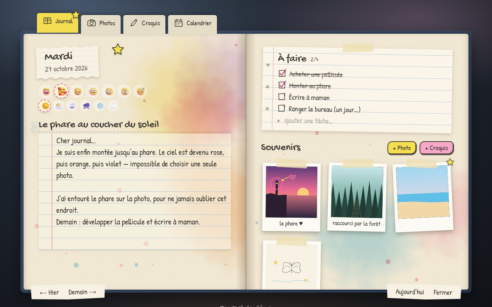
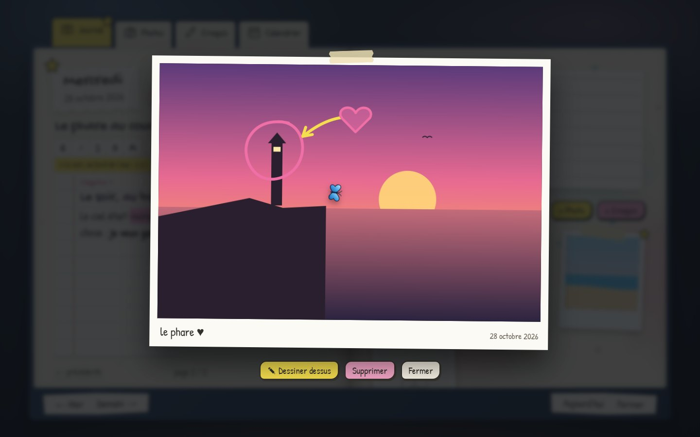
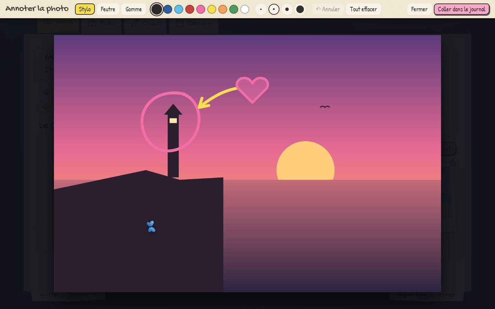
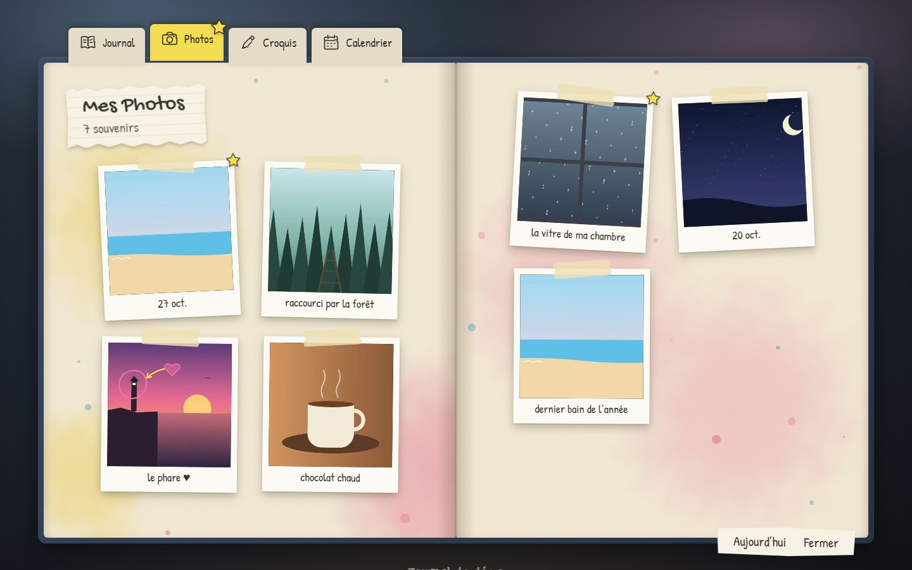
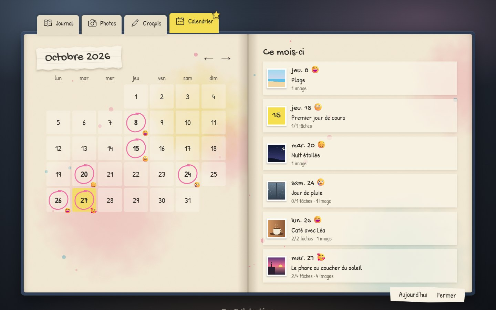
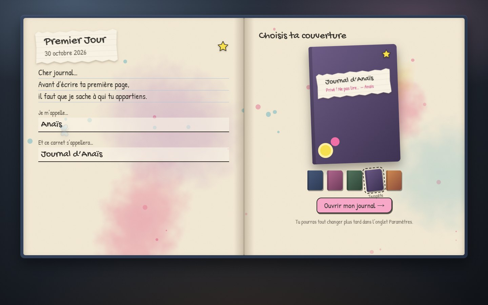
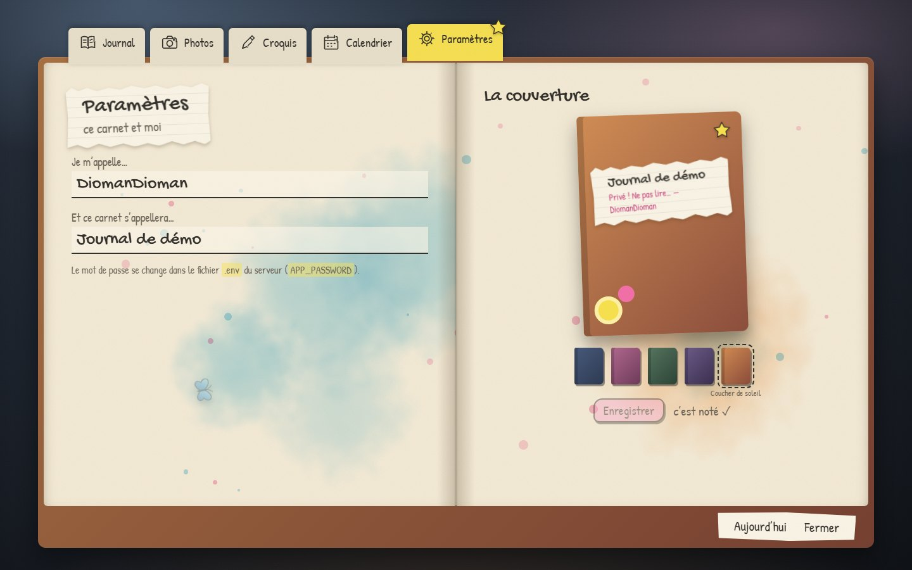
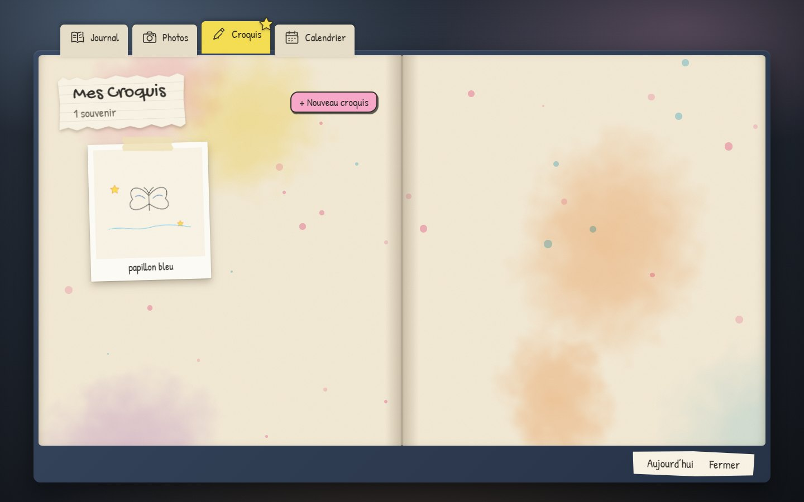
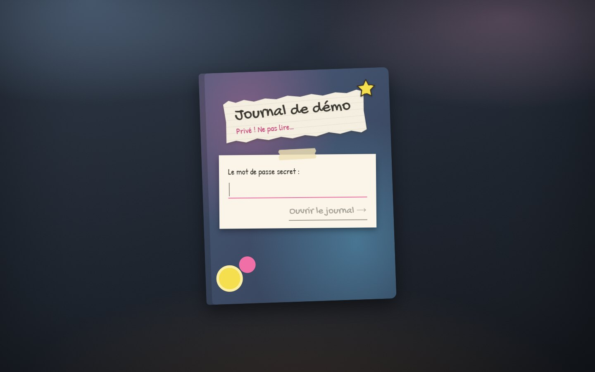
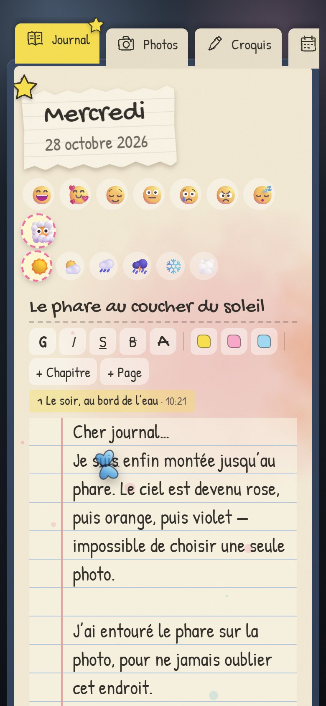

# 📓 Journal — carnet de vie façon aquarelle

Un journal intime auto-hébergé : pages crème, taches d'aquarelle, polaroïds scotchés,
étoiles jaunes, écriture manuscrite et un petit papillon bleu qui passe de temps en temps.

> 🎮 **Inspiration** : le design est inspiré du journal de Max dans le jeu vidéo
> **[Life is Strange](https://lifeisstrange.square-enix-games.com/)** (Dontnod / Square Enix).
> Ce projet est une création personnelle de fan, non officielle et sans lien avec ses éditeurs :
> aucune ressource du jeu (images, polices, sons) n'est utilisée. Tous les visuels sont recréés en CSS/SVG.

L'ancienne to-do list (JavaScript vanilla) est conservée dans [`legacy/`](legacy/) ; ses tâches vivent
maintenant dans la liste « À faire » de chaque journée.

## 📸 Aperçu



| Photo annotée | Éditeur de dessin |
| --- | --- |
|  |  |
| **Album photos** | **Calendrier** |
|  |  |
| **Premier jour (première configuration)** | **Paramètres** |
|  |  |
| **Carnet de croquis** | **Couverture (connexion)** |
|  |  |

<p align="center"></p>

*Captures réalisées sur une instance de démonstration avec de fausses données.*

## ✨ Fonctionnalités

- **Première ouverture** : tu choisis ton mot de passe (enregistré en base sous forme d’empreinte, jamais en clair), puis le journal demande ton prénom, propose un titre (« Journal de Max », « Journal d’Anaïs ») et une couverture parmi cinq ambiances aquarelle. Tout se change ensuite dans l’onglet **Paramètres** (les journaux déjà installés passent directement par cet onglet).
- **Une double page par jour** : date sur papier déchiré, humeurs (plusieurs à la fois, dont « Dans les nuages ») et météo en stickers, titre.
- **Un carnet page par page** : le texte s'écrit sur des pages lignées de taille fixe, sans défilement. Quand une page est pleine, la suite passe toute seule à la page suivante ; « + Page » (ou Ctrl+Entrée) commence une nouvelle page sans finir la courante. Enregistrement automatique.
- **Arracher une page** : les ciseaux ✂ sous la feuille retirent la page affichée (après confirmation). Elle part dans la **corbeille**, qui ne se vide jamais toute seule : on peut la recoller à sa place à tout moment, remettre les photos ou croquis retirés, ou les effacer pour toujours (élément par élément ou « Vider la corbeille », après confirmation).
- **Déplacer une journée** : écrit au mauvais jour ? « ↪ Déplacer » (sous le carnet) envoie toute la journée (texte, humeurs, météo, tâches, photos, croquis) vers un autre jour, à condition qu'il soit encore vide : deux journées ne sont jamais mélangées.
- **Chapitres** : « + Chapitre » ouvre un nouveau chapitre dans la même journée (numéroté, avec l'heure). Le sommaire du jour permet d'y sauter.
- **Mise en forme** : gras, italique, souligné, barré, texte en grand, surligneur jaune / rose / bleu.
- **Correcteur français** : fautes d'orthographe soulignées en rouge, de grammaire en bleu ; clic droit pour les suggestions, « Ignorer » ou « Ajouter au dictionnaire ». Moteur LanguageTool exécuté en local (le texte ne quitte pas la machine) ; s'il ne répond pas, le correcteur du navigateur prend le relais.
- **À faire** : tâches du jour, cochées au stylo et barrées à la main. Une tâche longue (jusqu’à 1000 caractères) passe à la ligne sur les lignes du papier, et la rature suit chaque ligne.
- **Souvenirs** : ajoute des photos (bouton ou glisser-déposer) ; elles apparaissent en polaroïds.
- **Dessiner sur les photos** : stylo (sensible à la pression avec un stylet), feutre transparent, gomme, 9 couleurs, annuler (Ctrl+Z). L'annotation est un calque séparé : la photo d'origine n'est jamais modifiée.
- **Croquis** : pages blanches à dessiner, rangées dans le carnet de croquis.
- **Albums** Photos / Croquis feuilletables, **calendrier** avec les jours remplis entourés.
- **Animations** : feuilletage des pages, polaroïds qui tombent et se « développent », étoiles qui popent, papillon (désactivé si le système demande moins d'animations).
- Navigation au clavier : ← / → pour changer de jour.
- Responsive : sur téléphone, les pages s'empilent.

## 🧱 Stack

| Partie | Outils |
| --- | --- |
| Front | React 18, Vite, Framer Motion, polices Patrick Hand & Gochi Hand (auto-hébergées via Fontsource) |
| API | Node.js, Express, Multer, Sharp (rotation EXIF, redimensionnement, vignettes WebP) |
| Données | PostgreSQL 17 : embarqué (PGlite, WebAssembly) dans l'application, ou serveur classique (`pg`) avec Docker ; images dans un dossier |
| Sauvegardes | Un `.zip` (toutes les tables + toutes les images) : à la demande, automatique, et repris au premier lancement d'un journal neuf |
| Éditeur | TipTap (ProseMirror), pages en colonnes CSS |
| Correcteur | LanguageTool 6.8 (conteneur local avec Docker, ~1 Go de RAM) ; sinon le correcteur du navigateur |
| Bureau | Electron 44 : le journal complet dans l'application (sans Docker), installateur NSIS via electron-builder |
| Ops | Docker Compose en option (VPS), Caddy (HTTPS), GitHub Actions |

## 🚀 Lancer sur ton PC

**Le plus simple : l'application de bureau** (Windows), qui contient tout le journal — serveur et base
de données — sans Docker ni rien d'autre à installer. Voir [Application de bureau](#️-application-de-bureau-windows).

Sans l'application, avec Node.js 22 ou plus, depuis la racine du dépôt :

```bash
(cd web && npm install && npm run build)
```

```bash
(cd server && npm install && PUBLIC_DIR=../web/dist PORT=8080 npm start)
```

Ouvre <http://localhost:8080>. Les données sont dans `server/data/` (base embarquée, images, sauvegardes).

**Avec Docker** (option, utile sur un VPS) : `cp .env.example .env`, remplis `POSTGRES_PASSWORD`
(`openssl rand -hex 32`), puis `docker compose up -d --build` et ouvre <http://localhost:8080>.
Docker ajoute un serveur PostgreSQL séparé et le correcteur LanguageTool.

Au premier lancement, tu choisis ton mot de passe (ou tu reprends une sauvegarde), puis ton prénom et ta couverture.

Par défaut le journal n'écoute que sur ce PC (`APP_BIND=127.0.0.1`). Pour y accéder depuis ton
téléphone sur le même Wi-Fi, mets `APP_BIND=0.0.0.0` puis ouvre `http://<ip-du-pc>:8080`.

## 🌍 Héberger sur un VPS (HTTPS)

1. Fais pointer un nom de domaine (enregistrement A) vers l'IP du VPS.
2. Copie le projet sur le VPS, crée le `.env` et ajoute :
   ```
   DOMAIN=journal.mondomaine.fr
   COOKIE_SECURE=true
   TRUST_PROXY=true
   ```
3. Lance avec le profil HTTPS (Caddy obtient le certificat Let's Encrypt tout seul) :
   ```bash
   docker compose --profile https up -d --build
   ```
4. Ouvre les ports 80 et 443 du pare-feu. Le port 8080 reste limité à `127.0.0.1`.
5. Récupère le **code d’installation** et ouvre `https://journal.mondomaine.fr` pour choisir ton mot de passe :
   ```bash
   docker compose logs app
   ```

## 🔐 Mot de passe

Le mot de passe est enregistré **en base** (table `settings`), sous forme d’empreinte scrypt : il n’est
jamais stocké en clair, ni dans la base ni dans `.env`. Le secret qui signe les sessions y est aussi.

- **Premier lancement** : on choisit le mot de passe à l’écran. Si le journal est joignable par d’autres
  machines (`DOMAIN`, `APP_BIND=0.0.0.0`, `COOKIE_SECURE` ou `TRUST_PROXY`), un **code d’installation**
  à 6 chiffres est aussi demandé : il s’affiche dans `docker compose logs app`. Sur un journal qui n’écoute
  que sur ce PC (réglage par défaut), pas de code. `SETUP_CODE=always` ou `never` force l’un ou l’autre.
- **Changer** : onglet **Paramètres** → « Changer le mot de passe » (l’ancien est demandé). Les autres
  appareils sont déconnectés.
- **Mot de passe oublié** : sur la machine qui héberge le journal, puis reconnecte-toi avec le nouveau.
  Avec Docker :
  ```bash
  docker compose exec app node src/reset-password.js
  ```
  Avec l'application de bureau : la fermer d'abord, installer [Node.js](https://nodejs.org) 22 ou plus,
  puis lancer le serveur fourni avec l'application (dossier d'installation, par défaut
  `%LOCALAPPDATA%\Programs\Journal`) :
  ```bash
  (cd "$LOCALAPPDATA/Programs/Journal/resources/server" && DATA_DIR="$APPDATA/Journal/journal" node src/reset-password.js)
  ```
- **Anciennes installations** : `APP_PASSWORD` et `SESSION_SECRET` présents dans `.env` sont importés
  automatiquement au démarrage (une seule fois, sessions ouvertes conservées). Tu peux ensuite retirer
  ces deux lignes du `.env` : la base fait foi.

## 💾 Sauvegardes

Une sauvegarde est **un seul fichier** `journal_<date>.zip` : toutes les tables (journées, tâches,
corbeille, dictionnaire, réglages — le mot de passe n'y est qu'en empreinte) et toutes les images.
Le même fichier marche partout : application de bureau, `node`, Docker.

- **À la demande** : onglet **Paramètres** → **Sauvegardes** → « Faire une sauvegarde maintenant ».
  Les dernières sont listées, avec un lien pour les télécharger.
- **Automatique** : au démarrage si la dernière a plus de 24 h, puis toutes les `BACKUP_INTERVAL_HOURS`
  heures. Celles de plus de `BACKUP_KEEP_DAYS` jours sont rangées, mais **les 5 dernières restent toujours**.
- **Où** : application de bureau → `Documents\Journal\Sauvegardes`, modifiable dans Paramètres
  (« changer de dossier », par exemple un dossier OneDrive) ; `node` → `server/data/backups` ou
  `BACKUP_DIR` ; Docker → volume `zips` (téléchargement depuis l'interface).
- **En ligne de commande** : `node src/backup-cli.js` (application fermée) ou
  `docker compose exec app node src/backup-cli.js`.

**Restaurer** : sur un journal **neuf** (aucun mot de passe, aucune donnée), le premier écran propose
« J'ai déjà un journal : reprendre une sauvegarde ». Le fichier est vérifié, tout est importé d'un bloc,
puis les comptages (journées, tâches, médias, caractères, corbeille) sont comparés à ceux de la sauvegarde :
au moindre écart, rien n'est gardé. Le mot de passe est **celui de la sauvegarde**. Un journal qui contient
déjà des données refuse la restauration : elle ne remplace jamais rien.

Les images supprimées depuis l'appli sont seulement masquées : le fichier reste sur le disque
(et dans les sauvegardes). Les pages arrachées sont gardées dans la table `trash`. Tout se
retrouve dans l'onglet **Corbeille**, qui n'est jamais vidé automatiquement. Un élément effacé pour
toujours depuis la corbeille reste dans les sauvegardes déjà faites, jusqu'à leur rotation.

### 🚚 Passer du journal Docker à l'application de bureau

1. Fais une sauvegarde `.zip` du journal Docker : depuis ses Paramètres (une fois à jour), ou
   `docker compose exec app node src/backup-cli.js`, puis récupère le fichier (lien « télécharger »).
2. Installe l'application de bureau, choisis « Sur cet ordinateur », puis « reprendre une sauvegarde »
   et donne-lui le `.zip`. Connecte-toi avec ton mot de passe habituel.
3. Vérifie que tout est là. Le journal Docker n'est jamais modifié : tu peux l'arrêter
   (`docker compose stop`) et ne le supprimer que lorsque tu es sûr.

### 🐳 Sauvegardes du journal Docker (PostgreSQL)

Avec Docker, le service `backup` fait en plus, au démarrage puis toutes les `BACKUP_INTERVAL_HOURS` heures,
une copie au format PostgreSQL : `backups/db_<date>.dump` (base, `pg_dump`) et
`backups/uploads_<date>.tar.gz` (images), supprimées après `BACKUP_KEEP_DAYS` jours.

```bash
docker compose exec backup sh /scripts/backup.sh once
```

Restaurer ce format (⚠️ remplace les données actuelles) : `docker compose stop app`, puis
`docker compose run --rm --entrypoint sh backup /scripts/restore.sh 2026-10-27_030000`, puis
`docker compose start app`. Sans horodatage, `restore.sh` liste les sauvegardes disponibles.
Sous Git Bash (Windows), préfixe les commandes avec `MSYS_NO_PATHCONV=1`. Ces fichiers ne se
reprennent pas dans l'application de bureau : pour elle, utilise le `.zip`.

### 🚚 Réinstaller sur un nouveau VPS à partir d'une sauvegarde

Le plus simple : installe le journal neuf, puis « reprendre une sauvegarde » au premier lancement
avec un `.zip` (il faut le code d'installation affiché par `docker compose logs app`).
Avec le format PostgreSQL : recrée le `.env` (seul `POSTGRES_PASSWORD` est nécessaire), copie
`db_<date>.dump` et `uploads_<date>.tar.gz` dans `BACKUP_DIR`, puis `docker compose up -d db`,
`docker compose run --rm --entrypoint sh backup /scripts/restore.sh <date>` et
`docker compose --profile https up -d --build`.

### ⚠️ Ce que la sauvegarde ne couvre pas

- **Une panne du disque** : par défaut les sauvegardes sont sur le même disque que les données.
  Choisis un dossier synchronisé (OneDrive…) ou copie-les ailleurs, idéalement chiffrées : c'est un journal intime.
- **Le fichier `.env`** (Docker) : il n'est pas sauvegardé (il contient `POSTGRES_PASSWORD`). Range-le dans un gestionnaire de mots de passe.
- **Restaurer une ancienne sauvegarde remet aussi l'ancien mot de passe du journal** (il est en base).
- **Les échecs** : une sauvegarde automatique ratée s'affiche dans Paramètres → Sauvegardes et dans les logs ; aucune alerte n'est envoyée.

## ✍️ Changer la police

Les polices manuscrites sont définies en haut de [`web/src/styles.css`](web/src/styles.css)
(`--font-hand` et `--font-title`). Pour utiliser une police à toi (fichier `.woff2`/`.ttf` dont tu as la licence) :

1. Place le fichier dans `web/public/fonts/`, par exemple `ma-police.woff2`.
2. Ajoute en haut de `styles.css` :
   ```css
   @font-face { font-family: 'MaPolice'; src: url('/fonts/ma-police.woff2') format('woff2'); font-display: swap; }
   ```
3. Mets `'MaPolice'` en premier dans `--font-hand` / `--font-title`, puis reconstruis : `docker compose up -d --build app`.

## 🖥️ Application de bureau (Windows)

Le dossier [`desktop/`](desktop/) contient une application Electron qui **contient tout le journal** :
le serveur et une base PostgreSQL embarquée (PGlite, en WebAssembly) tournent dans l'application. Pas de
Docker, pas de service à installer, rien à démarrer à la main.

- **Données** : `%APPDATA%\Journal\journal` (base `db/`, images `uploads/`).
- **Sauvegardes** : `Documents\Journal\Sauvegardes` par défaut, modifiable dans Paramètres.
- **Premier lancement** : « Sur cet ordinateur » (recommandé) ou « Sur un serveur » (VPS, ou l'ancien
  journal Docker : `http://localhost:8080`). Puis mot de passe — ou reprise d'une sauvegarde `.zip`.
- Le journal reste ouvert dans le navigateur tant que l'application tourne : `http://127.0.0.1:8080`
  (8081, 8082… si le port est pris), uniquement depuis ce PC.
- Correcteur : celui de Windows (soulignement rouge, suggestions au clic droit). LanguageTool n'est
  utilisé qu'avec Docker pour l'instant.
- Option « ouvrir au démarrage de Windows », fenêtre et taille mémorisées, une seule instance.
- Sécurité : seul le journal s'affiche dans la fenêtre ; les liens externes s'ouvrent dans le navigateur ;
  aucune permission (caméra, micro…) accordée.
- Journal de fonctionnement : `%APPDATA%\Journal\journal-desktop.log`.

### Installer

Télécharge `Journal Setup x.y.z.exe` depuis les
[Releases GitHub](https://github.com/Dioman-Keita/to-do-list-app/releases), puis lance-le.
L'installateur n'est pas signé (une signature de code demande un certificat payant) : Windows SmartScreen
affiche « Windows a protégé votre ordinateur » → **Informations complémentaires** → **Exécuter quand même**.
La configuration est dans `%APPDATA%\Journal\config.json`. Une ancienne configuration « journal Docker
sur ce PC » passe automatiquement au journal intégré : il démarre vide et propose de reprendre une sauvegarde.

### Intégration continue

Le workflow [`desktop.yml`](.github/workflows/desktop.yml) tourne sur Windows à chaque PR ou push sur `main`
qui touche `desktop/`, `server/` ou `web/` : construction du front et de l'installateur, puis **tests de
démarrage** (écran de premier lancement, puis journal intégré qui répond et propose une reprise de sauvegarde).
L'installateur est téléchargeable dans l'onglet **Actions** du dépôt (artefact `journal-desktop-windows`,
conservé 30 jours).

Publier une version (crée une Release GitHub avec le `.exe`) :

```bash
git tag desktop-v2.0.0
```

```bash
git push origin desktop-v2.0.0
```

Le numéro du tag devient la version de l'application (workflow [`desktop-release.yml`](.github/workflows/desktop-release.yml)).

### Construire sur son PC

```bash
(cd web && npm install && npm run build)
```

```bash
(cd server && npm ci --omit=dev)
```

```bash
(cd desktop && npm install && node node_modules/electron/install.js && npm run dist)
```

`node node_modules/electron/install.js` télécharge Electron lui-même : les versions récentes de npm
bloquent les scripts d'installation des paquets. L'installateur est créé dans `desktop/dist/` et embarque
`server/` et `web/dist/`. `npm start` lance l'application sans l'installer ; `--profile=<dossier>` utilise
un profil (et donc un journal) séparé.

## 📱 Application Android (APK)

Le dossier [`mobile/`](mobile/) contient une application Android **autonome** : tout le journal tourne
dans le téléphone, hors ligne, sans serveur ni PC. C'est le même front, et le même cœur que le serveur
([`server/src/core/`](server/src/core/) : migrations, SQL, règles de la corbeille, du déplacement…) ;
seuls changent le stockage et le traitement des images.

- **Base** : PGlite (PostgreSQL en WebAssembly), dans le stockage de l'application.
- **Images** : redressées, réduites et converties en miniatures par le téléphone ; servies par un
  service worker ([`web/public/media-sw.js`](web/public/media-sw.js)).
- **Mot de passe** : même empreinte que sur le PC. Le journal se verrouille à chaque lancement.
- **Sauvegardes** : le même `.zip` que sur le PC, dans `Documents/Journal/Sauvegardes` du téléphone
  (à la demande et toutes les 24 h), avec un bouton « partager » (Drive, clé USB…).
- **Premier lancement** : « reprendre une sauvegarde » accepte un `.zip` du PC, et inversement.
- **Deux journaux séparés** : ce qui est écrit sur le téléphone ne va pas sur le PC. Le passage de
  l'un à l'autre se fait par une sauvegarde `.zip`.
- **Désinstaller l'application efface son journal** (pas les sauvegardes dans Documents). Le journal
  n'est jamais envoyé dans la sauvegarde Google du téléphone (`allowBackup="false"`).
- **Correcteur** : celui du clavier Android.

### Installer

Télécharge `Journal-x.y.z.apk` depuis les [Releases GitHub](https://github.com/Dioman-Keita/to-do-list-app/releases)
sur le téléphone, ouvre-le et autorise l'installation depuis cette source (« sources inconnues »).
Les mises à jour s'installent par-dessus : le journal est gardé.

### Intégration continue et versions

Le workflow [`android.yml`](.github/workflows/android.yml) construit un APK de test à chaque PR qui touche
`mobile/`, `web/` ou `server/src/core/`, puis le lance dans un téléphone simulé : démarrage de la base,
images servies, choix du mot de passe, relance (la base doit survivre). L'APK est dans l'onglet **Actions**
(artefact `journal-android`). Un APK de test est signé avec une clé jetable : désinstaller l'application
avant d'installer une vraie version.

Publier une version signée (crée une Release GitHub avec l'APK) :

```bash
git tag android-v1.0.0
```

```bash
git push origin android-v1.0.0
```

La signature utilise **toujours la même clé**, rangée dans les secrets du dépôt (`JOURNAL_KEYSTORE_B64`,
`JOURNAL_KEYSTORE_PASSWORD`, `JOURNAL_KEY_ALIAS`). Sans elle, Android refuse les mises à jour : il faudrait
désinstaller, donc effacer le journal. Garde une copie de la clé hors de GitHub (gestionnaire de mots de passe).

### Construire et essayer

```bash
(cd web && npm install && npm run dev:telephone)
```

Le journal autonome s'ouvre dans le navigateur sur <http://localhost:5174> (données dans le navigateur).
Pour le projet Android (il faut Android Studio ou le SDK Android et Java 21) :

```bash
(cd mobile && npm install && npm run sync && cd android && ./gradlew assembleDebug)
```

`node mobile/make-icons.mjs` régénère les icônes et l'écran de démarrage.

## 🛠️ Développement

Aucun service à lancer : sans `DATABASE_URL` ni `PGHOST`, le serveur utilise la base embarquée
(`server/data/`).

```bash
(cd server && npm install && npm run dev)
```

```bash
(cd web && npm install && npm run dev)
```

Le front tourne sur <http://localhost:5173> et redirige `/api` et `/media` vers l'API (port 3000).
Pour travailler sur un PostgreSQL classique, définis `DATABASE_URL` (ou `PGHOST`, `PGUSER`…).

## 📁 Structure

```
server/        API Express (auth, journées, tâches, médias, migrations, sauvegardes .zip), base embarquée ou PostgreSQL
web/           Front React (carnet, éditeur de dessin, albums, calendrier)
backup/        Sauvegarde / restauration au format PostgreSQL (conteneur `backup`, Docker)
legacy/        Ancienne to-do list en JavaScript vanilla
desktop/       Application de bureau Electron : le journal complet, sans Docker (installateur)
mobile/        Application Android (Capacitor) : le journal autonome dans le téléphone (APK)
docs/          Captures d'écran et direction artistique (docs/design/)
.github/       Intégration continue (installateur Windows, publication des versions)
AGENTS.md      Guide pour les agents IA (CLAUDE.md l'importe)
Dockerfile     Image unique : build du front + serveur Node
docker-compose.yml   Option Docker (VPS) : app + PostgreSQL + LanguageTool + sauvegardes
```
